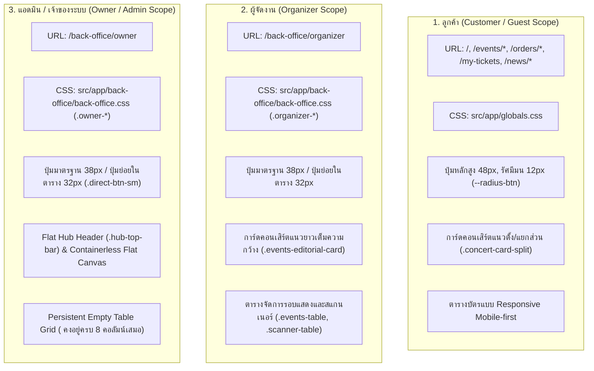

# TICKET — สถาปัตยกรรมดีไซน์ แคตตาล็อก UI และรายงานตรวจสอบความซ้ำซ้อน (Design System Audit & Style Catalog)

> **แหล่งข้อมูลอ้างอิงหลัก**: ข้อตกลงจาก [docs/requirement.md](file:///d:/PROJECTs/TICKET/docs/requirement.md) (D-14, D-76, D-119, D-124, D-223, D-231, D-233, D-250, D-251, D-280, D-281, D-282, D-283, D-284) และ [CONTEXT.md](file:///d:/PROJECTs/TICKET/CONTEXT.md)  
> **วันที่มีผลบังคับใช้**: 2026-11-23

---

## 1. บทนำและปรัชญาการออกแบบหลัก (Core Design Philosophy)

### 1.1 "Aesthetics Unified, Scopes Isolated" (สไตล์สวยงามเป็นหนึ่งเดียว แต่แยกการเรียกใช้ CSS ตามบทบาท)
ระบบ TICKET กำหนดให้ทั้ง 3 บทบาทของผู้ใช้งาน:
1. **ลูกค้า / ผู้ซื้อ (Customer / Guest Scope)**
2. **ผู้จัดงาน / ผู้ว่าจ้าง (Organizer Back-Office Scope)**
3. **แอดมิน / เจ้าของระบบ (Owner / Admin Back-Office Scope)**

**มีภาษาวิชวลและสไตล์ที่สอดคล้องกัน 100% (Coherent Aesthetics)** ได้แก่:
- **สีขาวบริสุทธิ์และโมโนโครมขาว-ดำ-เทา (Pure White & Monochrome Black — Tixxa Reference / D-280)**: พื้นหลังหลัก `#ffffff`, พื้นผิว canvas `#f8fafc`, เส้นขอบบางประณีต `#e2e8f0`, ตัวหนังสือและปุ่มหลักสีดำเข้ม `#0f172a`, ปุ่มรองสีขาวขอบเทา `#cbd5e1`
- **Zero Emojis 100% (D-14)**: ปราศจากอิโมจิตกแต่งในทุกปุ่ม หัวข้อ หรือสถานะ ใช้ไอคอน SVG (เช่น CheckCircle, AlertTriangle, ShieldCheck) เท่านั้น
- **Kanit Typography Weight System (D-281)**: ตัวหน้า/ตัวหนา/หัวข้อ/ปุ่มกด ใช้ **Kanit Regular 400** (`font-weight: 400`) ส่วนตัวบาง/เนื้อหา/ข้อมูลตาราง ใช้ **Kanit ExtraLight 200** (`font-weight: 200`) ไม่ใช้ 600 หรือ 700 ทั่วทั้งระบบ
- **Containerless Flat Canvas (D-231, D-233, D-284)**: วางผืนงานเรียบราบบน Canvas ไร้กล่องครอบซ้อนกล่อง (No nested card-in-card)

**แต่แยกการเรียกใช้ CSS (Role-Scoped CSS Architecture) อย่างเด็ดขาด**:
- ห้ามเขียน Selector กลางที่ส่งผลกระทบข้ามบทบาท (ห้ามเขียน CSS ในหน้า Admin ไป override หน้าลูกค้า หรือเขียนหน้าลูกค้าไปแทรกแซงหน้าหลังบ้าน)
- แยกไฟล์และการตั้งชื่อ Class ตามขอบเขตบทบาทอย่างชัดเจน

---

## 2. การแบ่งขอบเขตและมาตรฐานตามบทบาท (3-Tier Role Standards)



### สรุปความแตกต่างของสเปกระดับบทบาท
| รายละเอียด | ลูกค้า (Customer Scope) | ผู้จัดงาน (Organizer Scope) | แอดมิน/Owner (Admin Scope) |
| --- | --- | --- | --- |
| **ไฟล์ CSS ประจำบทบาท** | `src/app/globals.css` | `src/app/back-office/back-office.css` | `src/app/back-office/back-office.css` |
| **ความสูงปุ่มหลัก/มาตรฐาน** | **48px** (จับถนัดบนมือถือ) | **38px** (ความกระชับระดับ Enterprise) | **38px** (ความกระชับระดับ Enterprise) |
| **ความสูงปุ่มย่อย/ในตาราง** | **38px** หรือ 40px | **32px** (`.direct-btn-sm`, `.btn-sm`) | **32px** (`.direct-btn-sm`, `.row-action-btn`) |
| **รัศมีมุมปุ่ม (Border Radius)** | `12px` (`--radius-btn`) | `8px` (มาตรฐาน) / `6px` (ปุ่มย่อย 32px) | `8px` (มาตรฐาน) / `6px` (ปุ่มย่อย 32px) |
| **โครงสร้างส่วนหัวหน้าจอ** | Hero Navbar & Search Filter | แถบสถานะแท็บขีดล่าง (`.events-status-tabs`) | Flat Hub Header (`.hub-top-bar`) |
| **รูปแบบการ์ดหลัก** | Vertical Poster & Split Card | Horizontal Row Card แนวยาว | Flat Canvas Hubs + KPI Strip ขาวดำ 4 ช่อง |
| **โครงสร้างตารางว่าง** | Empty State Message Box | Persistent Table Grid | Persistent Table Grid (D-282) |
| **ระบบแจ้งเตือนผลลัพธ์** | Toast / Modal | Toast Notification (D-251) | Admin Refresh Timestamp Toast (D-251/D-282) |

---

## 3. แคตตาล็อกองค์ประกอบ UI ในระบบ (Master UI Component Catalog)

### 3.1 แคตตาล็อกปุ่ม (Buttons Catalog)

| ชื่อคลาสปุ่ม (Button Class) | ขอบเขต (Role Scope) | ความสูง & รูปทรง | สไตล์สี (Color Styling) | หน้าที่และการใช้งาน | สถานะ |
| --- | --- | --- | --- | --- | --- |
| `.primary-button` | Global / All | 48px (Customer)<br>38px (Back-Office) | พื้นหลัง `#0f172a`<br>ตัวหนังสือ `#ffffff`<br>hover: `#1e293b` | ปุ่มดำเนินการหลัก (Primary CTA) เช่น "ซื้อบัตร", "บันทึกข้อมูล", "ยืนยัน" | **Active Standard** |
| `.secondary-button` | Global / All | 48px (Customer)<br>38px (Back-Office) | พื้นหลัง `#ffffff`<br>ขอบ `#cbd5e1`<br>ตัวหนังสือ `#334155`<br>hover: `#f8fafc` | ปุ่มรอง (Secondary Action) เช่น "คืนค่าเริ่มต้น", "ปิด", "ส่งอีเมลซ้ำ" | **Active Standard** |
| `.direct-btn-sm` | Back-Office (Owner & Organizer) | 32px (height: 32px; min-height: 32px)<br>radius: 6px | ขาวขอบเทา หรือ ดำทึบ ตาม context | ปุ่มย่อยในแถวตารางและใน Modal เช่น "ส่งอีเมลซ้ำ", "ดาวน์โหลด", "รายละเอียด" | **Active Standard (D-282)** |
| `.btn-sm` / `.row-action-btn` | Back-Office | 32px, radius: 6px | ขาวขอบเทา `#cbd5e1` | ปุ่มขนาดกะทัดรัดสำหรับจัดการรายการ | **Active Standard** |
| `.modal-close-btn` | Global / All | 32px x 32px<br>radius: 6px | โปร่งใส (transparent)<br>hover: `#f1f5f9` (ไอคอน `#0f172a`) | ปุ่มปิด Modal/Popup ด้านบนขวา (ห้ามมีกรอบดำทึบเด็ดขาด ตาม D-282) | **Active Standard** |
| `.hub-refresh-btn` | Owner Back-Office | 38px, radius: 8px | ขาวขอบเทา `#cbd5e1` | ปุ่มรีเฟรชข้อมูลในหน้า Hub พร้อมเรียกใช้ Timestamp Toast | **Active Standard** |
| `.card-split-buy-btn` | Customer (Public) | 36px, radius: 8px | ดำ `#0f172a`, ข้อความขาว | ปุ่ม "ซื้อบัตร" ภายในการ์ดคอนเสิร์ตหน้าแรก | **Active (Customer)** |
| `.checkout-sticky-confirm-btn`| Customer (Public) | 48px, radius: 12px | ดำ `#0f172a`, ข้อความขาว | ปุ่มยืนยันชำระเงินแถบล่างสุดของหน้าชำระเงิน | **Active (Customer)** |
| `.email-variable-chip-btn` | Owner Back-Office | 26px, radius: 6px | เทาอ่อน `#f8fafc` ขอบ `#cbd5e1` | ชิปสำหรับกดแทรกตัวแปรลงในกล่องข้อความอีเมล (D-284) | **Active (Owner)** |
| `.email-preview-mode-btn` | Owner Back-Office | 28px, radius: 6px | ดำ `#0f172a` เมื่อ active | ปุ่มสลับพรีวิว Desktop (600px) / Mobile (375px) | **Active (Owner)** |
| `.btn-form-submit` | Organizer | 38px | ดำ `#0f172a` | ปุ่มส่งแบบฟอร์มสร้าง/แก้ไขคอนเสิร์ต | *ซ้ำซ้อนกับ `.primary-button`* |
| `.btn-form-cancel` | Organizer | 38px | ขาวขอบเทา `#cbd5e1` | ปุ่มยกเลิกแบบฟอร์ม | *ซ้ำซ้อนกับ `.secondary-button`* |
| `.btn-form-draft` | Organizer | 38px | ขาวขอบเทา `#cbd5e1` | ปุ่มบันทึกฉบับร่าง | *ซ้ำซ้อนกับ `.secondary-button`* |
| `.btn-submit-modal` | Organizer | 38px | ดำ `#0f172a` | ปุ่มยืนยันใน Popup ของผู้จัดงาน | *ซ้ำซ้อนกับ `.primary-button`* |
| `.btn-cancel-modal` | Organizer | 38px | ขาวขอบเทา `#cbd5e1` | ปุ่มยกเลิกใน Popup ของผู้จัดงาน | *ซ้ำซ้อนกับ `.secondary-button`* |
| `.ui-btn` / `.ui-btn-primary` | Global (Legacy) | ไม่ระบุ | สีฟ้าสด `#1848ed` | คลาส UI Generic สไตล์ Tailwind ตกค้าง | **Dead / Junk CSS** |

---

### 3.2 แคตตาล็อกการ์ด (Cards Catalog)

| ชื่อคลาสการ์ด (Card Class) | ขอบเขต (Role Scope) | โครงสร้างและวิชวล | หน้าที่และการใช้งาน | สถานะ |
| --- | --- | --- | --- | --- |
| `.concert-card-split` | Customer (Public) | Split Card: โปสเตอร์บน ข้อมูลล่าง พร้อมเส้นแบ่ง | การ์ดคอนเสิร์ตในหน้าแรกและหน้าแคตตาล็อก | **Active Standard (Public)** |
| `.event-hero-card` | Customer (Public) | แบนเนอร์ขนาดใหญ่ ขอบ `#e2e8f0` | การ์ดข้อมูลส่วนบนในหน้ารายละเอียดคอนเสิร์ต | **Active Standard (Public)** |
| `.ticket-detail-card` | Customer (Public) | ขาวบริสุทธิ์ ขอบ `#e2e8f0`, radius 16px | การ์ดแสดงตั๋วบัตรคอนเสิร์ตของลูกค้า | **Active Standard (Public)** |
| `.payment-qr-card` | Customer (Public) | ขาวบริสุทธิ์ ขอบ `#e2e8f0`, QR กึ่งกลาง | การ์ดแสดง PromptPay QR Code พร้อมตัวนับเวลา 15 นาที | **Active Standard (Public)** |
| `.news-magazine-card` | Customer (Public) | รูปภาพประกอบบน หัวข้อและเนื้อหาล่าง | การ์ดข่าวสารและประชาสัมพันธ์หน้าแรก/ข่าว | **Active Standard (Public)** |
| `.direct-kpi-card` | Back-Office (Owner) | ขาวบริสุทธิ์ ขอบบาง `#e2e8f0`, radius 10px | การ์ดสรุปสถิติ 4 ช่อง (โควตาทั้งหมด, ออกแล้ว, คงเหลือ, เพิกถอน) | **Active Standard (D-280)** |
| `.direct-modal-card` | Back-Office (Owner) | ขาวบริสุทธิ์ ขอบบาง `#e2e8f0`, radius 12px | การ์ดหน้าต่าง Popup สำหรับออกบัตรตรงและดูรายละเอียด | **Active Standard (D-280)** |
| `.events-editorial-card` | Organizer Back-Office | Full-width Horizontal Row Card (แนวยาว) | การ์ดรายการคอนเสิร์ตในหน้าผู้จัดงาน (D-231) | **Active Standard (Organizer)** |
| `.organizer-stat-card` | Organizer Back-Office | ขาว ขอบบาง `#e2e8f0` | การ์ดสถิติภาพรวมของผู้จัดงาน | **Active Standard (Organizer)** |
| `.email-designer-editor-pane` | Owner Back-Office | ขาว ขอบบาง `#e2e8f0`, radius 12px, scrollable | แผงปรับแต่งค่าเทมเพลตอีเมลฝั่งซ้าย (D-284) | **Active Standard (Owner)** |
| `.email-designer-preview-pane`| Owner Back-Office | เทาอ่อน `#f1f5f9` ขอบ `#e2e8f0`, scrollable | ผืนผ้าใบ Live Preview ฝั่งขวา (D-284) | **Active Standard (Owner)** |
| `.owner-section-header` | Owner Back-Office | ขาว ขอบ `#e2e8f0`, radius 16px | การ์ดหัวข้อหน้าเก่า (ถูกซ่อนในทุก Hub เพื่อ Flat Canvas) | **Legacy / Deprecated** |
| `.ui-card` / `.ui-card-content`| Global (Legacy) | Generic card wrapper | ไม่มีการใช้งานใน component ใดเลย | **Dead / Junk CSS** |

---

### 3.3 แคตตาล็อกตาราง (Tables Catalog)

| ชื่อคลาสตาราง (Table Class) | ขอบเขต (Role Scope) | โครงสร้าง (Structure) | พฤติกรรมเมื่อไม่มีข้อมูล (Empty State) | สถานะ |
| --- | --- | --- | --- | --- |
| `.direct-data-table` | Back-Office (Owner & Organizer) | `<table>` 8 คอลัมน์, เส้นแบ่ง `#e2e8f0`, หัวตารางเทาอ่อน `#f8fafc` | **Persistent Empty Grid (D-282)**: คงหัวตารางครบ 8 คอลัมน์เสมอ และแสดงแถวแจ้งเตือนด้านใน `<tbody>` | **Active Standard** |
| `.events-table` | Organizer Back-Office | `<table>` จัดการรอบแสดงและประเภทบัตร | แสดงโครงสร้างตารางพร้อมข้อความแจ้งสถานะ | **Active Standard** |
| `.scanner-table` | Back-Office (Both) | `<table>` รายชื่อและรหัสเครื่องสแกน | แสดงโครงสร้างตารางพร้อมข้อความแจ้งสถานะ | **Active Standard** |
| `.finance-table` | Back-Office (Both) | `<table>` แสดงรอบจ่ายเงินและประวัติโอน | แสดงโครงสร้างตารางพร้อมข้อความแจ้งสถานะ | **Active Standard** |
| `.ticket-types-table` | Customer (Public) | ตารางประเภทบัตรในหน้าคอนเสิร์ต | สลับเป็นการ์ดแนวตั้งบน Mobile Viewport | **Active Standard (Public)** |
| `.memo-items-table` | Back-Office | ตารางรายการเอกสารบันทึกช่วยจำ | ซ้ำซ้อนกับสไตล์ตารางมาตรฐานหลังบ้าน | *ควรยุบรวมกับตารางมาตรฐาน* |

---

## 4. รายงานตรวจสอบความซ้ำซ้อน ชิ้นส่วนที่ไม่ตรงมาตรฐาน และ CSS ขยะ (Audit Findings)

### 4.1 กลุ่มที่ 1: CSS ขยะที่ไม่ได้ใช้งานจริงเลย (Dead / Unused Junk CSS)
จากการสแกนโค้ด `.tsx` ทั้งหมดใน `src/` พบว่ามีคลาสต่อไปนี้ถูกนิยามทิ้งไว้ใน `globals.css` และ `back-office.css` แต่ไม่มีส่วนประกอบใดในระบบเรียกใช้งานเลย:
1. **Generic UI Kit ตกค้างใน `globals.css` (lines 500–650)**:
   - `.ui-btn`, `.ui-btn-primary`, `.ui-btn-danger`, `.ui-btn-outline`, `.ui-btn-full`, `.ui-btn-spinner`
   - `.ui-card`, `.ui-card-content`, `.ui-card-header`, `.ui-card-footer`, `.ui-card-title`, `.ui-card-interactive`
2. **คลาสทดลองที่ตกค้างใน `back-office.css`**:
   - `.aspect-action-btn`, `.channel-action-btn`
   - `.ticket-status-dist-card`
   - `.limit-mode-tab-btn`

> **คำแนะนำ**: ในการทำความสะอาด Codebase (Refactoring Task) สามารถนำคลาสชุดนี้ออกได้ทั้งหมดโดยไม่ส่งผลกระทบต่อ UI หรือการทำงานใด ๆ

### 4.2 กลุ่มที่ 2: ปุ่มที่ตั้งชื่อซ้ำซ้อน ทั้งที่มีปุ่มมาตรฐานอยู่แล้ว (Duplicate Buttons)
ในไฟล์ `src/components/organizer-events-manager.tsx` และ `src/components/organizer-news-view.tsx` มีการประกาศชื่อคลาสปุ่มเฉพาะกิจซ้ำซ้อน:
- `.btn-form-submit` และ `.btn-submit-modal` ➡️ แท้จริงแล้วคือสไตล์เดียวกับ `.primary-button`
- `.btn-form-cancel`, `.btn-form-draft`, และ `.btn-cancel-modal` ➡️ แท้จริงแล้วคือสไตล์เดียวกับ `.secondary-button`

> **คำแนะนำ**: สามารถแทนที่ด้วย `.primary-button` และ `.secondary-button` ได้ทันที เพื่อลดความซ้ำซ้อนของ CSS ลงกว่า 150 บรรทัด และเป็นไปตามข้อกำหนด D-282

### 4.3 กลุ่มที่ 3: กับดักกล่องครอบซ้อนกล่อง (Nested Card Box Trap)
- **ปัญหาเดิมใน `back-office.css` (line 10303)**:
  มีการเขียน Selector กว้างเกินไป:
  ```css
  .owner-section-body > div:not(.owner-concert-management-hub):not(...):not(...) {
    background: #ffffff;
    border: 1px solid #e2e8f0;
    border-radius: 16px;
    box-shadow: 0 4px 20px -2px rgba(15, 23, 42, 0.05);
    padding: clamp(1.25rem, 2.5vw, 2rem);
  }
  ```
  Selector นี้ทำให้ทุกครั้งที่สร้างหน้า Hub ใหม่ (เช่น `direct-tickets`, `email-designer`, `refunds`, `finance`) หน้าจอจะถูกบังคับใส่กล่องสีขาวขอบมนครอบทับโดยอัตโนมัติ ส่งผลให้เกิดปัญหากล่องครอบซ้อนกล่อง (Card inside Card) ที่ผู้ใช้ต้องคอยท้วงติง
- **แนวทางแก้ไขถาวร**:
  เปลี่ยนวิธีจากการใช้ `:not(...)` แบบ Blacklist เป็นการกำหนด Class ชัดเจน เช่น `.floating-form-card` สำหรับหน้าที่ต้องการกล่องลอยจริง ๆ เท่านั้น ส่วนหน้า Hub ให้ใช้ Flat Canvas เป็น Default

### 4.4 กลุ่มที่ 4: การละเมิดมาตรฐานสี Generic AI (Blue Color Invasions)
- ในบางส่วนที่สร้างขึ้นช่วงแรก มีการใช้สีฟ้าสด `#1848ed`, `#2563eb`, `#eff6ff` ในปุ่มและคอนโทรล (เช่น ใน Email Designer เดิม)
- ตามข้อกำหนด **D-280**: ห้ามใช้สีฟ้า/น้ำเงินแบบ AI บนปุ่มควบคุมระบบหลังบ้านเด็ดขาด ต้องใช้สีโมโนโครมดำเข้ม `#0f172a` และขาวขอบเทา `#cbd5e1` เท่านั้น (สีอื่นอนุญาตเฉพาะไอคอนหรือป้ายสถานะ D-11: เขียว=สำเร็จ, เหลือง=เตือน, แดง=ยกเลิก)

---

## 5. กติกาปฏิบัติการสำหรับการพัฒนาและ AI ในอนาคต (AI & Developer Golden Rules)

เพื่อให้ทุกหน้าในระบบ (ลูกค้า, ผู้จัดงาน, แอดมิน) สอดคล้องเป็นมาตรฐานเดียวกัน 100% ตามคำสั่งของผู้ใช้:

1. **Rule 1: Check Before Create (ตรวจก่อนสร้าง)**
   ก่อนสร้าง Component, ปุ่ม, การ์ด, หรือตารางใหม่ **ต้องเปิดอ่านเอกสารนี้และตรวจสอบคลาสเดิมที่มีอยู่เสมอ** ห้ามสร้างคลาสปุ่มหรือการ์ดใหม่หากมีคลาสมาตรฐานรองรับอยู่แล้ว
2. **Rule 2: Strict Role Scoping (แยกขอบเขตบทบาทเด็ดขาด)**
   - สไตล์ลูกค้า ➡️ อยู่ใน `globals.css`
   - สไตล์ผู้จัดงานและแอดมิน ➡️ อยู่ใน `back-office.css` และต้องมี Selector กำกับบทบาทชัดเจน ห้าม override ข้ามฝั่ง
3. **Rule 3: Enforce Button Sizes (ล็อกขนาดปุ่มตามบทบาท)**
   - หน้าลูกค้า: ปุ่มหลักสูง `48px` มน `12px`
   - หน้าผู้จัดงานและแอดมิน: ปุ่มมาตรฐานสูง `38px` มน `8px`, ปุ่มย่อยในตาราง/Modal สูง `32px` มน `6px` เป๊ะ
4. **Rule 4: Zero Emojis (ปลอดอิโมจิ 100%)**
   ห้ามใช้อิโมจิตกแต่งในปุ่ม, หัวข้อ, หรือข้อความสถานะเด็ดขาด (D-14) ให้ใช้ SVG Icons จาก `src/components/icons.tsx` เท่านั้น
5. **Rule 5: Containerless Flat Canvas (วางราบบน Canvas เสมอ)**
   หน้า Hub หรือ Workspace ในระบบหลังบ้าน ห้ามสร้างกล่องการ์ดสีขาวครอบทั้งหน้าจอ ให้วางราบบน Canvas โดยตรงร่วมกับเส้นแบ่งบางคมชัด หรือจัดกลุ่มด้วยการ์ดแนวยาว / KPI Cards ย่อย
6. **Rule 6: Persistent Empty Table Grid (ตารางว่างต้องคงหัวตาราง)**
   เมื่อตารางไม่มีข้อมูล ห้ามซ่อน `<table>` แล้วแสดงกล่องข้อความลอยแทน ต้องคงโครงสร้าง `<thead>` ครบทุกคอลัมน์ และแสดงข้อความแจ้งเตือนกึ่งกลางภายในแถว `<tbody><tr><td colSpan={N}>` เสมอ (D-282)
7. **Rule 7: Ask Before Writing to .md (ถามก่อนเขียนลง .md)**
   เมื่อมีข้อกำหนดหรือการตัดสินใจใหม่ ต้องนำเสนอและถามเพื่อยืนยันกับผู้ใช้ก่อนเขียนลงในไฟล์ `.md` เสมอตามระเบียบปฏิบัติ
