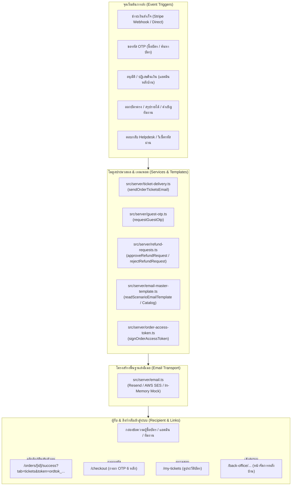
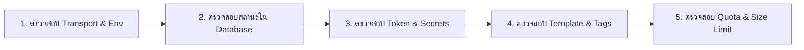

# สถาปัตยกรรมระบบอีเมล แผนที่หน้าจอ และคู่มือไล่หาสาเหตุบั๊ก (Email System Architecture, Page Dependency Map & Troubleshooting Guide)

เอกสารฉบับนี้เป็นแหล่งข้อมูลหลัก (Single Source of Truth) สำหรับนักพัฒนาและผู้ดูแลระบบในการทำความเข้าใจความสัมพันธ์ของระบบอีเมลแจ้งเตือนทุกสถานการณ์ในแพลตฟอร์ม TICKET ทั้ง **13 รูปแบบ ใน 4 หมวดหมู่หลัก** เชื่อมโยงกับ **หน้าเว็บฝั่งผู้ใช้ (User Frontend Pages)**, **เมนูจัดการหลังบ้าน (Back-office Menus)**, **ไฟล์โค้ดและจุดเรียกส่ง (APIs & Services)**, **ตารางฐานข้อมูล (Database Tables)** ตลอดจน **คู่มือไล่หาสาเหตุเมื่อพบบั๊กหรืออีเมลไม่ส่ง (Troubleshooting Guide)**

---

## 1. แผนภาพสถาปัตยกรรมระบบอีเมล (System Architecture)



---

## 2. ตารางสรุปภาพรวมความสัมพันธ์ทั้ง 13 รูปแบบ (Cross-Reference Matrix)

| รหัสประเภท (Key) | เหตุการณ์ที่ส่ง (Trigger) | หน้าเว็บผู้ใช้ (User Page) | เมนูหลังบ้าน (Admin/Organizer) | ไฟล์โค้ด & API หลัก | ตารางฐานข้อมูล |
|---|---|---|---|---|---|
| `ticket_delivery` | ลูกค้าชำระเงินสำเร็จ | `/orders/[id]/success?tab=tickets` | `/back-office/owner#email-designer`<br>`/back-office/owner#ticket-designer` | `src/server/ticket-delivery.ts`<br>`src/server/order-access-token.ts`<br>`src/app/api/stripe/webhook/route.ts` | `orders`<br>`tickets`<br>`ticket_email_deliveries`<br>`owner_email_master_template` |
| `checkout_otp` | ผู้ซื้อกรอกอีเมลก่อนจ่ายเงิน | `/checkout` (Modal OTP) | - | `src/server/guest-otp.ts`<br>`src/app/api/auth/otp/route.ts` | `guest_otp` |
| `lookup_otp` | ขอเปิดดูบัตร / Token หมดอายุ | `/my-tickets`<br>`OrderLinkOtpGate` | - | `src/server/guest-otp.ts`<br>`src/app/api/orders/lookup/route.ts` | `guest_otp` |
| `event_reminder` | ระบบเตือนล่วงหน้า 24-48 ชม. | `/orders/[id]/success?tab=tickets`<br>`/events/[slug]` | `/back-office/organizer#concerts` | `src/server/notifications/event-reminder.ts` | `event_sessions`<br>`orders`<br>`tickets` |
| `refund_approved` | แอดมินโอนเงินคืนสำเร็จ | `/orders/[id]/refund` | `/back-office/owner#refunds`<br>`/back-office/organizer#refunds` | `src/server/refund-requests.ts`<br>`src/app/api/owner/refunds/[id]/approve/route.ts` | `refund_requests`<br>`orders`<br>`tickets` |
| `refund_rejected` | แอดมินปฏิเสธคำขอคืนเงิน | `/orders/[id]/refund`<br>`/orders/[id]/success?tab=tickets` | `/back-office/owner#refunds`<br>`/back-office/organizer#refunds` | `src/server/refund-requests.ts`<br>`src/app/api/owner/refunds/[id]/reject/route.ts` | `refund_requests`<br>`orders` |
| `ticket_revoked` | เพิกถอนสิทธิ์บัตร / โมฆะ | `/my-tickets` | `/back-office/owner#orders`<br>`/scanner` (Gate Scanner) | `src/server/ticket-delivery.ts`<br>`src/app/api/owner/orders/[id]/revoke/route.ts` | `tickets` (status: `cancelled`) |
| `event_rescheduled` | ผู้จัดประกาศเลื่อน/ยกเลิกงาน | `/events/[slug]`<br>`/my-tickets` | `/back-office/owner#concerts`<br>`/back-office/organizer#concerts` | `src/server/session-cancellation.ts`<br>`src/app/api/owner/events/[id]/reschedule/route.ts` | `event_sessions`<br>`orders`<br>`reschedule_windows` |
| `direct_ticket` | แอดมินออกบัตร VIP / Sponsor | `/direct-tickets/view?token=...` | `/back-office/owner#direct-tickets`<br>(`AdminDirectTicketsHub`) | `src/server/direct-tickets.ts`<br>`src/app/api/owner/direct-tickets/issue/route.ts` | `direct_ticket_batches`<br>`tickets` |
| `organizer_payout` | โอนเงินส่วนแบ่งรายได้ประจำสัปดาห์ | - | `/back-office/owner#finances`<br>`/back-office/organizer#finance` | `src/server/weekly-manual-payout.ts`<br>`src/app/api/owner/payouts/settle/route.ts` | `organizer_payout_settlements` |
| `staff_invitation` | เชิญทีมงาน / สแกนเนอร์ใหม่ | `/invitations/accept?token=...` | `/back-office/owner#staff`<br>`/back-office/organizer#staff` | `src/server/invitations.ts`<br>`src/app/api/invitations/create/route.ts` | `invitations`<br>`users` |
| `password_reset` | ทีมงานกดลืมรหัสผ่าน | `/back-office/reset-password?token=...` | `/back-office/login` | `src/server/auth.ts`<br>`src/app/api/auth/[...all]/route.ts` | `verification`<br>`user` |
| `support_reply` | แอดมินตอบกลับข้อความช่วยเหลือ | `/support/tickets/[id]`<br>`/contact` | `/back-office/owner#support` | `src/server/inbound-email.ts`<br>`src/app/api/owner/support/[id]/reply/route.ts` | `support_tickets`<br>`support_messages` |

---

## 3. รายละเอียดเชิงลึกและจุดตรวจสอบรายกรณี (Deep-Dive & Troubleshooting)

---

### หมวดที่ 1: ผู้ซื้อบัตร / ลูกค้า (Customer & Ticketing)

#### 1.1 อีเมลส่งมอบบัตรคอนเสิร์ต & QR Code (`ticket_delivery`)
- **บทบาท**: จัดส่งรูปบัตรคอนเสิร์ตจริงและ QR Code ให้ลูกค้าทันทีที่ชำระเงินสมบูรณ์
- **หน้าเว็บและเมนูที่เกี่ยวข้อง**:
  - `src/components/admin-email-designer.tsx`: หน้าออกแบบและกำหนดข้อความ/โปสเตอร์/สีปุ่มของอีเมลส่งบัตร (`/back-office/owner#email-designer`)
  - `src/components/admin-ticket-designer.tsx`: หน้าออกแบบรูปภาพและองค์ประกอบบนบัตรคอนเสิร์ตจริง (`/back-office/owner#ticket-designer`)
  - `src/components/ticket-canvas-download.ts`: ฟังก์ชัน `generateTicketDataUrl` เรนเดอร์การ์ดรูปภาพบัตรความละเอียดสูง
  - `src/app/orders/[id]/success/page.tsx`: หน้ารับบัตรเมื่อชำระเงินสำเร็จ
  - `src/components/order-success-view.tsx`: คอมโพเนนต์แสดงแท็บบัตรเข้างาน (`?tab=tickets`)
- **โค้ดและจุดเรียกส่ง (Code Implementation)**:
  - จุดเรียกส่ง: `sendOrderTicketsEmail()` ใน `src/server/ticket-delivery.ts` ถูกเรียกจาก Stripe Webhook (`src/app/api/stripe/webhook/route.ts`) หรือ Mock Payment endpoint
  - โครงสร้างอีเมล: `buildTicketEmailContent()` ใน `src/server/ticket-delivery.ts`
  - การลงนามลายเซ็นดิจิทัล: `signOrderAccessToken()` ใน `src/server/order-access-token.ts`
- **ตารางฐานข้อมูล**:
  - `orders`: บันทึกสถานะคำสั่งซื้อ (`status = 'paid'`)
  - `tickets`: บันทึกข้อมูลบัตรทุกใบ รหัสบัตร (`ticketCode`) และ QR payload
  - `ticket_email_deliveries`: บันทึกประวัติการส่งอีเมลเพื่อป้องกันการส่งซ้ำ (Idempotency)
  - `owner_email_master_template`: บันทึกเทมเพลตที่แอดมินปรับแต่งไว้
- **คู่มือวิเคราะห์สาเหตุและวิธีแก้บั๊ก (Troubleshooting)**:
  - *อาการ: ลูกค้าชำระเงินแล้วแต่ไม่ได้รับอีเมลบัตร*
    1. ตรวจสอบตาราง `orders` ว่า `status` เป็น `'paid'` หรือไม่
    2. ตรวจสอบตาราง `ticket_email_deliveries` ว่ามีแถวของ `orderId` นั้นหรือไม่ และคอลัมน์ `status` เป็น `'delivered'` หรือ `'failed'`
    3. ตรวจสอบค่า `RESEND_API_KEY` หรือคอนฟิกอีเมลใน `.env.local`
  - *อาการ: รูปบัตรในอีเมลไม่แสดงผล หรืออีเมลถูกตัดข้อความ (Message clipped)*
    1. ตรวจสอบจำนวนบัตรในคำสั่งซื้อ หากมีมากกว่า 20 ใบ ระบบจะตัดรูปบัตรออกอัตโนมัติและแทนที่ด้วยตารางรหัสบัตรตาม **Quota Guard Policy** เพื่อป้องกันขนาดอีเมลเกิน 102 KB
  - *อาการ: ลูกค้าคลิกปุ่ม "เปิดดูบัตรผ่านเว็บไซต์" จากอีเมลแล้วติดหน้าต่างขอ OTP*
    1. ตรวจสอบพารามิเตอร์ URL ในอีเมลว่ามี `token=ordtok_...` แนบไปด้วยหรือไม่
    2. ตรวจสอบค่า `BETTER_AUTH_SECRET` หรือ `TICKET_ORDER_LINK_SECRET` ใน Environment Variables ว่ามีการเปลี่ยนค่ากะทันหันหรือไม่ (หากเปลี่ยนค่า ลายเซ็นโทเค็นเดิมจะถือว่าไม่ถูกต้องและระบบจะ fallback ไปยังหน้าต่าง OTP เพื่อความปลอดภัย)

---

#### 1.2 อีเมลรหัส OTP สำหรับยืนยันการซื้อบัตร (`checkout_otp`)
- **บทบาท**: ส่งรหัส 6 หลักยืนยันอีเมลในหน้าชำระเงิน
- **หน้าเว็บและเมนูที่เกี่ยวข้อง**:
  - `/checkout`: หน้าทำรายการสั่งซื้อและกรอกข้อมูลผู้ซื้อ
  - `src/components/checkout-view.tsx`: กล่องป๊อปอัปกรอกรหัส OTP ยืนยันตัวตน
- **โค้ดและจุดเรียกส่ง**:
  - ฟังก์ชัน: `requestGuestOtp()` ใน `src/server/guest-otp.ts`
  - API: `POST /api/auth/otp`
- **ตารางฐานข้อมูล**: `guest_otp` (เก็บ Hashed OTP, IP address, attempt count)
- **คู่มือวิเคราะห์สาเหตุและวิธีแก้บั๊ก**:
  - *อาการ: กดขอ OTP แล้วระบบแจ้งเตือนว่าจำกัดการทำรายการ (Rate Limited)*
    - ตรวจสอบตาราง `guest_otp` สำหรับ IP นั้น ระบบจำกัดไม่เกิน 20 ครั้งต่อ 15 นาที เพื่อป้องกันการยิงสแปม
  - *อาการ: กรอกรหัสถูกต้องแตะระบบบอกว่ารหัสไม่ถูกต้องหรือหมดอายุ*
    - รหัส OTP มีอายุ 5 นาที ตรวจสอบเวลา Server Time ว่าตรงกับเวลาจริงหรือไม่

---

#### 1.3 อีเมลรหัส OTP สำหรับค้นหาและเปิดดูบัตร (`lookup_otp`)
- **บทบาท**: ส่งรหัส OTP ยืนยันตัวตนเมื่อลูกค้าเข้าค้นหาบัตรผ่านหน้าเว็บโดยตรง
- **หน้าเว็บและเมนูที่เกี่ยวข้อง**:
  - `/my-tickets`: หน้าค้นหาและดูรายการบัตรของฉัน
  - `src/components/order-link-otp-gate.tsx`: หน้าต่างกรองความปลอดภัยเมื่อเปิดดูคำสั่งซื้อ
- **โค้ดและจุดเรียกส่ง**:
  - API: `POST /api/orders/lookup`
  - ฟังก์ชัน: `requestGuestOtp(pool, { email, purpose: 'lookup' })`
- **ตารางฐานข้อมูล**: `guest_otp`

---

#### 1.4 อีเมลแจ้งเตือนใกล้ถึงวันคอนเสิร์ต 24-48 ชม. (`event_reminder`)
- **บทบาท**: แจ้งเตือนผู้ถือบัตรล่วงหน้า 1-2 วันก่อนวันงาน พร้อมข้อมูลประตูเปิดและการเตรียมตัว
- **หน้าเว็บและเมนูที่เกี่ยวข้อง**:
  - `/events/[slug]`: หน้ารายละเอียดงานคอนเสิร์ต
  - `/back-office/organizer#concerts`: คอนเสิร์ตฮับของผู้จัดงาน
- **โค้ดและจุดเรียกส่ง**:
  - Scheduled Background Worker / Batch trigger
  - Service: `readScenarioEmailTemplate(pool, 'event_reminder')` ใน `src/server/email-master-template.ts`
- **ตารางฐานข้อมูล**: `event_sessions`, `orders`, `tickets`

---

### หมวดที่ 2: การเงิน คืนเงิน & นโยบาย (Finance, Refunds & Policy)

#### 2.1 อีเมลแจ้งผลอนุมัติการคืนเงินและสลิปหลักฐาน (`refund_approved`)
- **บทบาท**: แจ้งลูกค้าเมื่อแอดมินโอนเงินคืนเข้าบัญชีเรียบร้อยแล้ว พร้อมแนบรูปสลิป
- **หน้าเว็บและเมนูที่เกี่ยวข้อง**:
  - `/orders/[id]/refund`: หน้าสถานะคำขอคืนเงินของลูกค้า
  - `/back-office/owner#refunds`: ฮับจัดการคำขอคืนเงินของเจ้าของระบบ (`AdminRefundsHub`)
  - `/back-office/organizer#refunds`: หน้ารายการคืนเงินของผู้จัดงาน
- **โค้ดและจุดเรียกส่ง**:
  - API: `POST /api/owner/refunds/[id]/approve`
  - Service: `approveRefundRequest()` ใน `src/server/refund-requests.ts`
  - File Storage: `uploadFile()` ใน `src/server/storage.ts` (จัดเก็บรูปสลิปธนาคาร)
- **ตารางฐานข้อมูล**: `refund_requests` (สถานะ `'approved'`), `orders` (สถานะ `'refunded'`)
- **คู่มือวิเคราะห์สาเหตุและวิธีแก้บั๊ก**:
  - *อาการ: รูปสลิปในอีเมลไม่แสดงผล*
    - ตรวจสอบ URL ในคอลัมน์ `refund_requests.slipUrl` ว่าเป็น URL สาธารณะที่ปลอดภัย (HTTPS) หรือไม่

---

#### 2.2 อีเมลแจ้งปฏิเสธคำขอคืนเงิน (`refund_rejected`)
- **บทบาท**: แจ้งลูกค้าเมื่อคำขอคืนเงินไม่ผ่านเกณฑ์ พร้อมยืนยันว่าบัตรเดิมยังคงใช้เข้างานได้
- **หน้าเว็บและเมนูที่เกี่ยวข้อง**:
  - `/back-office/owner#refunds`: หน้าจัดการคำขอคืนเงิน
- **โค้ดและจุดเรียกส่ง**:
  - API: `POST /api/owner/refunds/[id]/reject`
  - Service: `rejectRefundRequest()` ใน `src/server/refund-requests.ts`
- **ตารางฐานข้อมูล**: `refund_requests` (สถานะ `'rejected'`), `tickets` (สถานะคงเป็น `'valid'`)

---

#### 2.3 อีเมลแจ้งเพิกถอนสิทธิ์บัตร / ยกเลิกบัตร (`ticket_revoked`)
- **บทบาท**: แจ้งผู้ถือบัตรเมื่อตรวจพบการทุจริตหรือการยกเลิกคำสั่งซื้อ และเตือนว่า QR เดิมโมฆะ
- **หน้าเว็บและเมนูที่เกี่ยวข้อง**:
  - `/back-office/owner#orders`: หน้าจัดการคำสั่งซื้อของแอดมิน
  - `/scanner`: ประตูสแกนบัตร (เมื่อนำบัตรที่ถูกยกเลิกมาสแกนจะขึ้นเตือนสีแดงทันที)
- **โค้ดและจุดเรียกส่ง**:
  - API: `POST /api/owner/orders/[id]/revoke`
  - Service: `updateTicketStatus()`
- **ตารางฐานข้อมูล**: `tickets` (สถานะ `'cancelled'`)

---

#### 2.4 อีเมลแจ้งเลื่อนรอบการแสดง หรือยกเลิกคอนเสิร์ต (`event_rescheduled`)
- **บทบาท**: ส่งแจ้งผู้ซื้อบัตรทุกคนเมื่อผู้จัดงานประกาศเปลี่ยนแปลงกำหนดการ
- **หน้าเว็บและเมนูที่เกี่ยวข้อง**:
  - `/events/[slug]`: หน้ารายละเอียดงานคอนเสิร์ต
  - `/back-office/organizer#concerts`: เมนูจัดการรอบการแสดง
- **โค้ดและจุดเรียกส่ง**:
  - API: `POST /api/owner/events/[id]/reschedule`
  - Service: `rescheduleEventSession()` ใน `src/server/session-cancellation.ts`
- **ตารางฐานข้อมูล**: `event_sessions`, `orders`, `reschedule_windows`

---

### หมวดที่ 3: ผู้จัดงาน & ทีมงานหลังบ้าน (Organizer & Staff)

#### 3.1 ส่งมอบบัตรตรง VIP / Sponsor (`direct_ticket`)
- **บทบาท**: ออกบัตรและส่งอีเมลให้แขกพิเศษ สปอนเซอร์ หรือกลุ่มคณะโดยตรง
- **หน้าเว็บและเมนูที่เกี่ยวข้อง**:
  - `/back-office/owner#direct-tickets`: หน้าออกบัตรตรง (`AdminDirectTicketsHub`)
  - `/direct-tickets/view?token=...`: หน้าเปิดดูบัตรตรงสำหรับแขกพิเศษ
- **โค้ดและจุดเรียกส่ง**:
  - API: `POST /api/owner/direct-tickets/issue`
  - Service: `issueDirectTickets()` ใน `src/server/direct-tickets.ts`
- **ตารางฐานข้อมูล**: `direct_ticket_batches`, `tickets`

---

#### 3.2 แจ้งสรุปการโอนเงินส่วนแบ่งรายได้ให้ผู้จัดงาน (`organizer_payout`)
- **บทบาท**: ส่งรายงานสรุปยอดขาย ค่าธรรมเนียม และสลิปการโอนเงินให้ผู้จัดงานประจำสัปดาห์
- **หน้าเว็บและเมนูที่เกี่ยวข้อง**:
  - `/back-office/owner#finances`: หน้าจัดการการเงินของแอดมิน
  - `/back-office/organizer#finance`: หน้ารายงานการเงินของผู้จัดงาน
- **โค้ดและจุดเรียกส่ง**:
  - API: `POST /api/owner/payouts/settle`
  - Service: `createOrganizerPayoutSettlement()` ใน `src/server/weekly-manual-payout.ts`
- **ตารางฐานข้อมูล**: `organizer_payout_settlements`

---

#### 3.3 คำเชิญเข้าร่วมเป็นทีมงานในระบบ TICKET (`staff_invitation`)
- **บทบาท**: ส่งคำเชิญให้เจ้าหน้าที่สแกนบัตรหรือผู้ช่วยผู้จัดงานตั้งรหัสผ่านเข้าใช้งาน (48 ชม.)
- **หน้าเว็บและเมนูที่เกี่ยวข้อง**:
  - `/back-office/owner#staff`: จัดการสิทธิ์ทีมงาน
  - `/invitations/accept?token=...`: หน้ายอมรับคำเชิญและตั้งรหัสผ่านใหม่
- **โค้ดและจุดเรียกส่ง**:
  - API: `POST /api/invitations/create`
  - Service: `createStaffInvitation()` ใน `src/server/invitations.ts`
- **ตารางฐานข้อมูล**: `invitations`, `users`

---

#### 3.4 ตั้งรหัสผ่านใหม่สำหรับทีมงานหลังบ้าน (`password_reset`)
- **บทบาท**: ส่งลิงก์รีเซ็ตรหัสผ่านแบบ Single-use อายุ 30 นาทีเมื่อทีมงานกดลืมรหัสผ่าน
- **หน้าเว็บและเมนูที่เกี่ยวข้อง**:
  - `/back-office/login`: หน้าเข้าสู่ระบบหลังบ้าน
  - `/back-office/forgot-password`: หน้าแจ้งลืมรหัสผ่าน
  - `/back-office/reset-password?token=...`: หน้าตั้งรหัสผ่านใหม่
- **โค้ดและจุดเรียกส่ง**:
  - Better-Auth API: `src/app/api/auth/[...all]/route.ts`
  - Service: `src/server/auth.ts`
- **ตารางฐานข้อมูล**: `verification`, `user`

---

### หมวดที่ 4: ฝ่ายบริการลูกค้า (Customer Support)

#### 4.1 ตอบกลับข้อความสอบถามช่วยเหลือลูกค้า (`support_reply`)
- **บทบาท**: ส่งอีเมลแจ้งลูกค้าเมื่อเจ้าหน้าที่ฝ่ายสนับสนุนตอบกลับคำร้องผ่าน Helpdesk
- **หน้าเว็บและเมนูที่เกี่ยวข้อง**:
  - `/contact`: หน้าติดต่อฝ่ายบริการลูกค้า
  - `/back-office/owner#support`: กล่องรับเรื่องร้องเรียนหลังบ้าน
  - `/support/tickets/[id]`: หน้าประวัติการสนทนาของลูกค้า
- **โค้ดและจุดเรียกส่ง**:
  - API: `POST /api/owner/support/[id]/reply`
  - Service: `src/server/inbound-email.ts`
- **ตารางฐานข้อมูล**: `support_tickets`, `support_messages`

---

## 3.5 ระบบจัดการชุดเทมเพลตสำหรับทุกส่วนของอีเมล (Template Presets: ทุกหมวดหมู่ ทุกกรณี)

ระบบรองรับ **แถบเครื่องมือจัดการชุดเทมเพลต (Template Presets Toolbar)** ครอบคลุม **ครบทั้ง 13 รูปแบบในทุกหมวดหมู่ของอีเมล** (Customer, Finance, Staff, Support) ไม่จำกัดเฉพาะกรณีส่งมอบบัตรเท่านั้น เพื่อให้ผู้ดูแลระบบสามารถสร้าง สลับใช้งาน เปลี่ยนชื่อ และบันทึกชุดเทมเพลตที่ปรับแต่งไว้ได้อย่างอิสระในแต่ละกรณี

### แถบเมนูและปุ่มควบคุมบนหน้าจอ (UI Controls)
- **แถบเลือกเทมเพลต (`เทมเพลต: [เลือก...]`)**:
  - ดรอปดาวน์แสดงชุดเทมเพลตที่บันทึกไว้ของ Scenario ที่กำลังเลือกอยู่ เช่น กรณี `checkout_otp` จะแสดงเทมเพลตของ OTP หรือกรณี `event_reminder` จะแสดงเทมเพลตของเตือนใกล้วันงาน
  - ค่าเริ่มต้นของแต่ละ Scenario จะถูกสร้างผ่าน `getDefaultScenarioPresets(scenarioKey)` เช่น `เทมเพลตมาตรฐานหลัก (Default Master)` สำหรับส่งมอบบัตร หรือ `เทมเพลตมาตรฐาน (รหัส OTP ยืนยันการซื้อบัตร)` สำหรับ OTP
  - เมื่อผู้ดูแลระบบเลือกเทมเพลตใด หน้าพรีวิวเสมือนจริงและการตั้งค่าของ Scenario นั้นจะเปลี่ยนตามทันที
- **ปุ่ม "เพิ่มเทมเพลต" (Add Template)**:
  - เปิดหน้าต่างป๊อปอัป (`Add Template Modal`) พร้อมแสดงชื่อ Scenario ที่กำลังสร้างให้อย่างชัดเจน
  - ระบบจะคัดลอกค่าการตั้งค่า รูปแบบ สี และข้อความปัจจุบันของ Scenario นั้นไปบันทึกเป็นชุด Preset ใหม่ พร้อมสร้าง ID อัตโนมัติ (`user-template-{scenario}-{timestamp}`)
- **ปุ่ม "แก้ไขชื่อ" (Rename Template)**:
  - เปิดหน้าต่างป๊อปอัป (`Rename Template Modal`) ให้แก้ไขชื่อของชุดเทมเพลตที่กำลังเลือกอยู่ใน Scenario นั้น
- **ปุ่ม "ลบ" (Delete Template)**:
  - ลบชุดเทมเพลตที่ไม่ต้องการออกจาก Scenario นั้น
  - **ระบบความปลอดภัยเฉพาะกรณี (Safety Guard Rule per Scenario)**: ระบบกำหนดว่าในแต่ละ Scenario ต้องมีเทมเพลตอย่างน้อย 1 แบบเสมอ หาก Scenario ใดเหลือเทมเพลตเพียง 1 แบบ ปุ่ม "ลบ" จะถูกปิดการใช้งาน (Disabled เป็นสีเทา) อัตโนมัติ เพื่อป้องกันระบบขาดเทมเพลตสำหรับส่งจริง

### โครงสร้างฐานข้อมูลและการจัดเก็บ (Database Schema & Persistence)
- **ตารางที่จัดเก็บ**: `owner_email_master_template` (Primary Key `id = TRUE`)
- **คอลัมน์ `data` (JSONB)**:
  - `scenarioPresets`: Object เก็บชุดเทมเพลตแยกตาม Scenario Key (เช่น `ticket_delivery`, `checkout_otp`, `event_reminder`, ฯลฯ)
  - `scenarioActivePresetIds`: Object เก็บ ID ของ Preset ที่กำลังเลือกใช้งานอยู่แยกตาม Scenario Key
  - `scenarioTemplates`: Object เก็บค่า `EmailTemplateState` ล่าสุดของแต่ละ Scenario
  - `presets` และ `activePresetId`: Array และ String ที่ซิงค์กับ `ticket_delivery` เสมอ เพื่อรักษาความเข้ากันได้แบบย้อนหลัง 100% (Backward Compatibility)
  - `template`: Object เก็บค่าเทมเพลตส่งมอบบัตรคอนเสิร์ตหลัก (`ticket_delivery`)

### ไฟล์โค้ดที่เกี่ยวข้อง (Code Implementation)
- **Frontend UI & Event Handlers**:
  - `src/components/admin-email-designer.tsx`:
    - `currentScenarioPresets`: ดึงชุดเทมเพลตของ Scenario ปัจจุบัน
    - `currentActivePresetId`: ดึง ID ของ Preset ที่กำลัง Active ของ Scenario ปัจจุบัน
    - `handleSelectPreset()`: สลับไปใช้ Preset อื่นใน Scenario ปัจจุบัน
    - `handleCreateNewTemplate()`: สร้าง Preset ใหม่ใน Scenario ปัจจุบัน
    - `handleRenameCurrentTemplate()`: เปลี่ยนชื่อ Preset ใน Scenario ปัจจุบัน
    - `handleDeleteActiveTemplate()`: ลบ Preset ที่เลือกใน Scenario ปัจจุบัน
    - `handleSaveDraftChanges()`: บันทึกการแก้ไขแบบฟอร์มลงทั้ง Preset และ `scenarioTemplates`
    - `persistPayload()`: ส่งบันทึก JSONB พร้อมกันทุกฟิลด์ไปยัง Backend
- **Data Model & Parsing**:
  - `src/lib/email-template.ts`:
    - `type EmailTemplatePreset`
    - `INITIAL_EMAIL_PRESETS`: เทมเพลตเริ่มต้นของ ticket_delivery
    - `getDefaultScenarioPresets(scenarioKey)`: สร้างชุด Preset เริ่มต้นสำหรับทั้ง 13 Scenarios
    - `parseEmailMasterPayload()`: ตรวจสอบความถูกต้องของ `scenarioPresets`, `scenarioActivePresetIds`, `presets`, และ `activePresetId`
- **Backend Service & API**:
  - `src/server/email-master-template.ts`:
    - `readEmailMasterPayload()`: โหลด Payload พร้อมชุด Preset ครบทุก Scenario
    - `readScenarioEmailTemplate()`: ดึงเทมเพลต Active ของ Scenario นั้นจาก `scenarioTemplates` หรือ Preset ที่ Active อยู่
    - `writeEmailMasterTemplate()`: บันทึก Payload ลงฐานข้อมูล
  - `src/app/api/owner/email-template/route.ts`: API Endpoint `GET` และ `POST`

### คู่มือตรวจสอบและแก้บั๊กสำหรับ Presets (Troubleshooting Presets)
- *อาการ: กดเพิ่มเทมเพลตใหม่ หรือแก้ไขชื่อ แล้วเมื่อรีเฟรชหน้าจอกลับเป็นค่าเดิม*
  1. ตรวจสอบสิทธิ์การเข้าสู่ระบบ: บัญชีที่เข้าใช้งานต้องมีบทบาทเป็น `'owner'` (เฉพาะเจ้าของระบบ)
  2. ตรวจสอบ Network Tab ในเบราว์เซอร์: ดูการเรียก `POST /api/owner/email-template` ว่าตอบกลับ HTTP 200 หรือไม่
  3. ตรวจสอบการเชื่อมต่อ Database PostgreSQL: ตาราง `owner_email_master_template` ต้องสามารถเขียนข้อมูล JSONB ได้
- *อาการ: ปุ่ม "ลบ" เป็นสีเทากดไม่ได้*
  1. นี่คือพฤติกรรมความปลอดภัยที่ถูกต้อง (Safety Guard) เมื่อใน Scenario นั้นมีเทมเพลตเหลืออยู่เพียง 1 แบบ ระบบจะป้องกันไม่ให้ลบเทมเพลตสุดท้าย เพื่อให้มีเทมเพลตสำรองสำหรับการส่งอีเมลในกรณีนั้นเสมอ
- *อาการ: อีเมลที่ส่งออกจากระบบในกรณีใดกรณีหนึ่ง (เช่น OTP หรือแจ้งเตือนงาน) ไม่ตรงกับเทมเพลตที่สร้างไว้*
  1. ตรวจสอบว่าได้กดเลือกใช้งานเทมเพลตนั้นในดรอปดาวน์แล้วหรือไม่ (`scenarioActivePresetIds` ในฐานข้อมูล) โดยระบบจะส่งอีเมลตามเทมเพลตที่ active อยู่ของกรณีนั้นเท่านั้น

---

## 4. ขั้นตอนการตรวจหาสาเหตุเมื่ออีเมลไม่ส่งหรือส่งบั๊ก (Standard Troubleshooting Checklist)

เมื่อเกิดเหตุขัดข้อง เช่น ลูกค้าแจ้งว่าไม่ได้รับอีเมล, รูปบัตรไม่ขึ้น, หรือโทเค็นหมดอายุ ให้ปฏิบัติตาม 5 ขั้นตอนนี้ตามลำดับ:



### ขั้นตอนที่ 1: ตรวจสอบระบบนำส่งอีเมล (Transport & Environment)
- ตรวจสอบใน `src/server/email.ts`:
  - บน Local Development: หากไม่ได้ใส่ `RESEND_API_KEY` ระบบจะใช้ In-Memory Transport และพ่นเนื้อหาอีเมลออกทาง Terminal Console
  - บน Production: ตรวจสอบว่า API Key หรือสิทธิ์ AWS SES ส่งผ่านได้ตามปกติ ไม่ติด Bounce หรือ Spam Block

### ขั้นตอนที่ 2: ตรวจสอบประวัติการส่งในฐานข้อมูล (Database Audit)
- สำหรับคำสั่งซื้อ รันคำสั่งตรวจสอบ:
  ```sql
  SELECT id, status, "buyerEmail", "updatedAt" FROM orders WHERE id = 'ORD-XXXX';
  SELECT * FROM ticket_email_deliveries WHERE "orderId" = 'ORD-XXXX';
  ```
- หากพบคอลัมน์ `status = 'failed'` ให้อ่านข้อความใน `error` เพื่อดูสาเหตุจาก Provider

### ขั้นตอนที่ 3: ตรวจสอบโทเค็นความปลอดภัย (Signed Token & Secrets)
- ตรวจสอบว่าลิงก์ในอีเมลมี `token=ordtok_...` ติดอยู่
- ตรวจสอบว่า Environment Variable `BETTER_AUTH_SECRET` หรือ `TICKET_ORDER_LINK_SECRET` ตรงกันทั้งตอนเซ็นและตอนถอดรหัส
- หากทดสอบบน Local Dev แล้วรีสตาร์ตเซิร์ฟเวอร์โดยไม่ได้ตั้ง Secret ค่า Secret ชั่วคราวจะเปลี่ยนไป ทำให้ลิงก์เดิมหมดอายุ

### ขั้นตอนที่ 4: ตรวจสอบการแทนค่าตัวแปรในเทมเพลต (Merge Tags)
- เปิดหน้า `/back-office/owner#email-designer`
- เลือกหมวดและประเภทอีเมลที่เกี่ยวข้อง
- ตรวจสอบว่าตัวแปรที่ใช้ เช่น `{{order_id}}`, `{{buyer_name}}`, `{{otp_code}}` สะกดถูกต้องตรงกับแท็กในเมนู หรือไม่
- กดปุ่ม **"ส่งอีเมลทดสอบ"** เพื่อรับตัวอย่างจริงเข้ากล่องจดหมายของแอดมินทันที

### ขั้นตอนที่ 5: ตรวจสอบโควตาและขนาดของอีเมล (Quota & Message Size)
- คำสั่งซื้อที่มีบัตรเกิน 20 ใบ จะต้องแสดงผลเป็น **ตารางสรุปรหัสบัตร** เท่านั้น ห้ามใส่รูปภาพบัตรหลายสิบใบเด็ดขาด เพราะจะทำให้อีเมลมีขนาดเกิน 102 KB และโดน Gmail ตัดข้อความ (Clipped Message)
